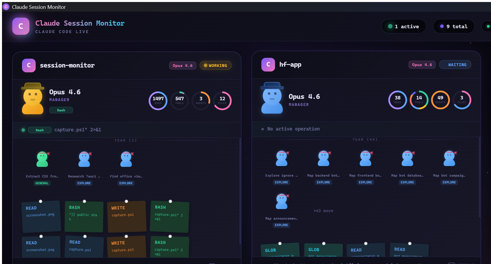

<div align="center">

# Claude Session Monitor

**Your Claude Code sessions are running. You should see what's happening.**<br>
**A real-time desktop dashboard that visualizes every session, agent, and tool call.**

Every session. Every spawned agent. Every tool call. Every file touched.<br>
Tracked, visualized, and displayed in a beautiful Office Cabin metaphor.

<br>

[](#-install)
[](https://github.com/boparaiamrit/claude-session-monitor)
[](https://github.com/boparaiamrit/claude-session-monitor/blob/main/LICENSE)
[](https://v2.tauri.app)

[](https://github.com/boparaiamrit)
[](https://x.com/boparaiamrit)
[](https://github.com/sponsors/boparaiamrit)

</div>

<p align="center">
  
</p>

---

## What is This?

**Claude Session Monitor** is a lightweight Tauri v2 desktop app that reads your Claude Code session files in real-time and presents them as a beautiful, interactive dashboard. Two views — **Classic** (list + detail) and **Office** (cabin metaphor with avatars, donuts, and sticky notes) — give you full visibility into what Claude is doing across all your projects.

> Your Claude Code sessions generate rich telemetry — messages, tool calls, spawned agents, file operations. This app reads it all from `~/.claude/projects/` and turns it into something you can actually *see*.

**It doesn't just show sessions. It shows the entire team — manager, agents, and their work.**

---

## Two Views

### Classic View

The traditional two-panel layout:

| | Panel | What it shows |
|:---:|:---|:---|
| Left | **Session List** | All active/recent sessions with status, model, tool count, agent count |
| Right | **Detail Panel** | Timeline, agents, chat, files — full breakdown of the selected session |

Both panels scroll independently. Session cards show tool-use sparklines and live status badges.

### Office View — The Cabin Metaphor

Each project becomes an **office cabin** with a visual team:

| | Element | What it represents |
|:---:|:---|:---|
| Manager | **Hero avatar at top** | The main Claude session — with donut charts for msgs, tools, agents, files |
| Workers | **Team grid below** | Spawned sub-agents with type-colored avatars and hachimaki headbands |
| Sticky Notes | **Colorful post-its** | Recent tool calls pinned to the cabin wall |
| Stream | **Live terminal** | Bottom-to-top accordion toggle showing real-time tool activity |
| Activity Band | **Current operation** | Pulsing bar showing what the manager is doing right now |

Worker types are visually distinct:

| Type | Color | Band |
|:---|:---|:---|
| Explore | Blue | Red headband |
| Researcher | Purple | Orange headband |
| Reviewer | Pink | Gold headband |
| Executor | Orange | Crimson headband |
| Planner | Yellow | Rose headband |
| General | Green | Coral headband |

---

## Features

| | Feature | Details |
|:---:|:---|:---|
| Desktop | **Native Tauri v2 app** | Fast, lightweight, cross-platform (Windows, macOS, Linux) |
| Real-time | **1.5s polling** | Sessions update automatically via Rust backend |
| Views | **Classic + Office** | Toggle between list view and cabin metaphor |
| Avatars | **CSS characters** | Animated avatars with blinking eyes, status colors, manager hats |
| Charts | **Donut charts** | Message ratio, tool distribution, agent count, files touched |
| Sticky Notes | **Tool cards** | Color-coded by tool type with slight rotation for a natural look |
| Stream | **Accordion toggle** | Smooth bottom-to-top CSS transition between workers and live stream |
| Tray | **System tray** | Minimize to tray, double-click to restore |
| Session Detail | **4-tab breakdown** | Timeline, Agents, Chat, Files — with full tool details |
| Overlay | **Click any avatar** | Opens a detail overlay for any session or agent |
| Filtering | **Active / All** | Filter by active sessions or show all within a time window |
| Auto-start | **Launch on boot** | Optional autostart via tauri-plugin-autostart |
| Single Instance | **One window** | Prevents duplicate instances |

---

## Tech Stack

| Layer | Technology |
|:---|:---|
| **Desktop** | [Tauri v2](https://v2.tauri.app) — Rust backend, WebView frontend |
| **Frontend** | React 19 + TypeScript + Vite 8 |
| **Charts** | [Recharts](https://recharts.org) — PieChart for donut visualizations |
| **Styling** | Pure CSS — custom properties, animations, gradients |
| **Backend** | Rust — file system polling, JSON parsing, session aggregation |
| **Plugins** | tauri-plugin-shell, window-state, single-instance, autostart, tray-icon |

---

## Install

### Download Pre-built Binaries

Head to the [Releases](https://github.com/boparaiamrit/claude-session-monitor/releases) page and download the installer for your platform:

| Platform | Format |
|:---|:---|
| **Windows** | `.msi` installer |
| **macOS** | `.dmg` disk image |
| **Linux** | `.deb` / `.AppImage` |

### Build From Source

**Prerequisites:** Node.js 18+, Rust 1.70+, and the [Tauri v2 prerequisites](https://v2.tauri.app/start/prerequisites/).

```bash
# Clone
git clone https://github.com/boparaiamrit/claude-session-monitor.git
cd claude-session-monitor

# Install dependencies
npm install

# Run in dev mode
npm run tauri:dev

# Build for production
npm run tauri:build
```

The built installer will be in `src-tauri/target/release/bundle/`.

---

## How It Works

```
┌──────────────────────────────────────────────────────────┐
│                   ~/.claude/projects/                     │
│                                                          │
│  session-abc123.jsonl   session-def456.jsonl   ...       │
└────────────────────────┬─────────────────────────────────┘
                         │  Rust reads & parses every 1.5s
                         ▼
┌──────────────────────────────────────────────────────────┐
│                  Tauri Rust Backend                       │
│                                                          │
│  • Scans ~/.claude/projects/*/.sessions.json             │
│  • Parses JSONL session files                            │
│  • Extracts: status, model, tools, agents, messages      │
│  • Aggregates & sorts by last activity                   │
│  • Emits "sessions-updated" event to frontend            │
└────────────────────────┬─────────────────────────────────┘
                         │  Tauri IPC events
                         ▼
┌──────────────────────────────────────────────────────────┐
│                 React Frontend                            │
│                                                          │
│  Classic View          │  Office View                    │
│  ┌─────────┬────────┐  │  ┌─────────────────────────┐   │
│  │ Session │ Detail │  │  │ ┌─Cabin──────────────┐  │   │
│  │  List   │ Panel  │  │  │ │ Manager + Donuts   │  │   │
│  │         │        │  │  │ │ Workers + Stickies │  │   │
│  │         │        │  │  │ │ Stream toggle      │  │   │
│  └─────────┴────────┘  │  │ └────────────────────┘  │   │
│                         │  └─────────────────────────┘   │
└──────────────────────────────────────────────────────────┘
```

The app reads Claude Code's native session files — no server, no API, no configuration needed. Just launch it and it finds your sessions automatically.

---

## Requirements

| | Requirement | Notes |
|:---:|:---|:---|
| **Claude Code** | Any version | Session files must exist at `~/.claude/projects/` |
| **OS** | Windows / macOS / Linux | Pre-built binaries available for all three |
| **Disk** | ~15 MB | Lightweight Tauri bundle |

---

## Contributing

Contributions welcome! Feel free to open issues or PRs.

**Areas for contribution:**
- Additional view layouts and themes
- Session search and filtering
- Notification system for session events
- Historical session analytics
- Custom dashboard widgets

---

## License

[MIT](LICENSE)

---

## Author

**Amritpal Singh** — [@boparaiamrit](https://github.com/boparaiamrit)

Built with [Claude Code](https://claude.ai/claude-code)

---

<p align="center">
  <sub>Made with intensity in India</sub>
</p>
