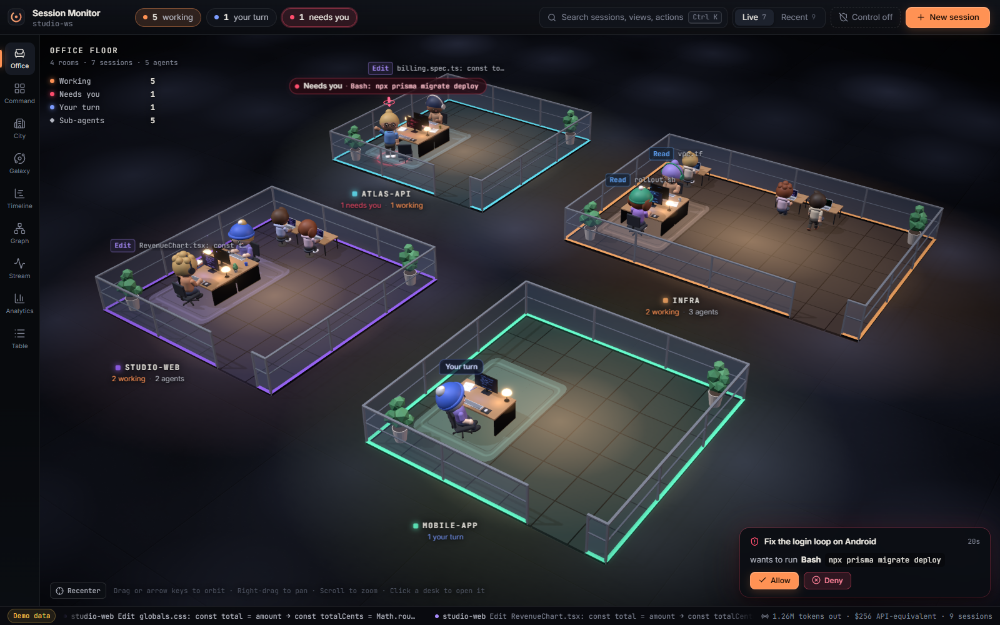
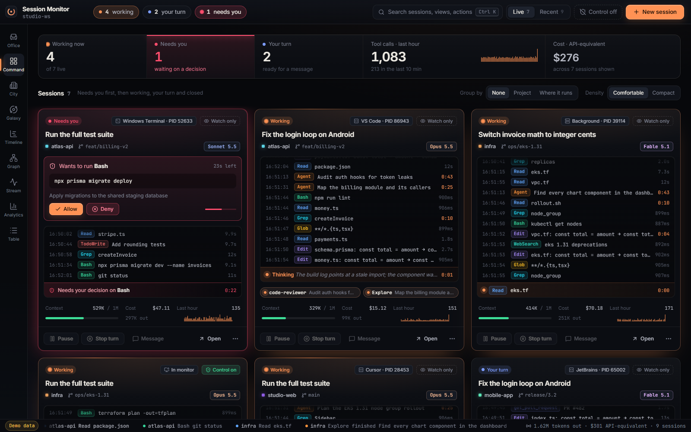
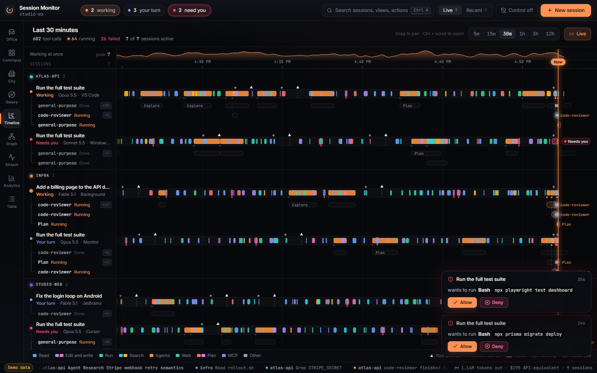
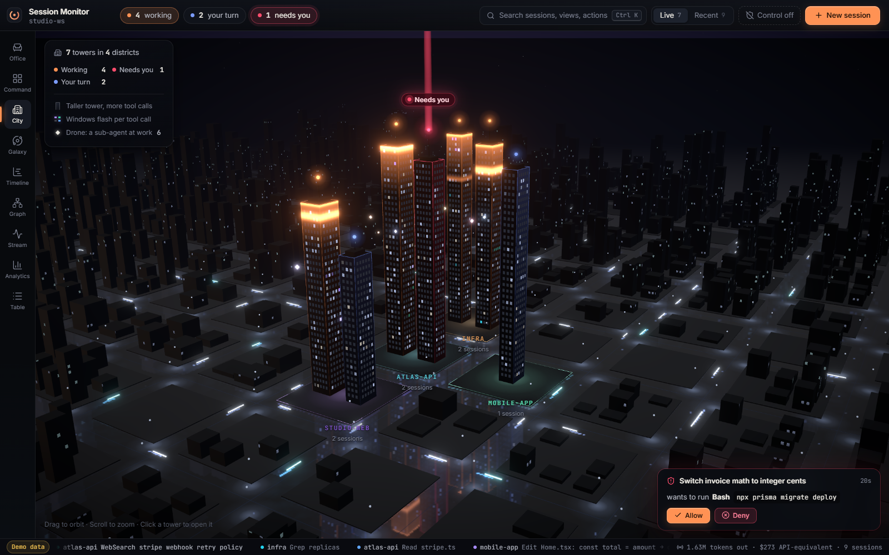
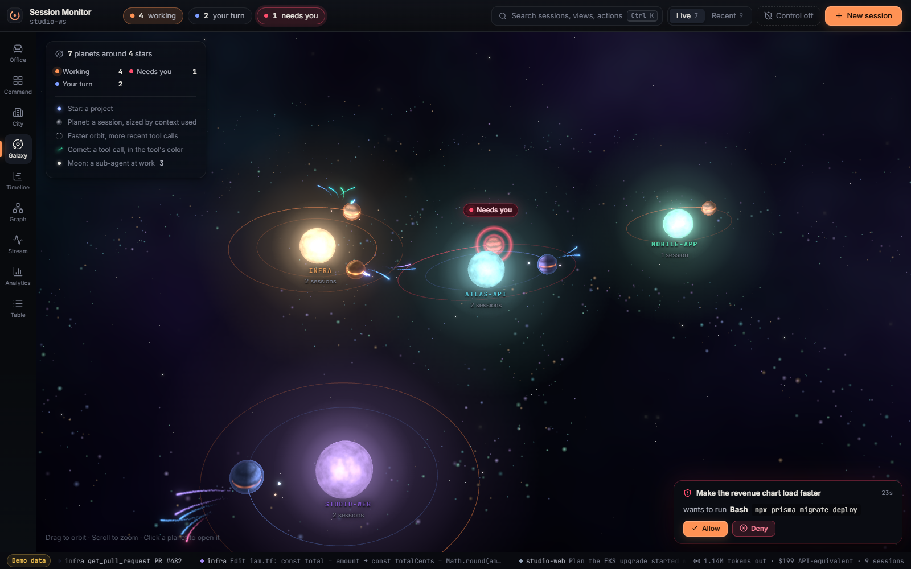

<div align="center">

# Claude Session Monitor

**Watch and control every Claude Code session from one window.**<br>
A desktop mission control for Claude Code: a live 3D office, approvals, pause and stop,<br>
messages into running sessions, and nine ways to see what your agents are doing.

<br>

[](#install)
[](https://github.com/boparaiamrit/claude-session-monitor)
[](https://github.com/boparaiamrit/claude-session-monitor/blob/main/LICENSE)
[](https://v2.tauri.app)

</div>

<p align="center">
  
</p>

---

## What's new in 2.0

- **Control, not just watching.** Allow or deny permission requests, pause before the next tool call, stop a turn, and send Claude a message, for sessions you started anywhere: a terminal, VS Code, JetBrains or the background.
- **Start sessions from the monitor.** Chat with them in the app, launch them in the background, or open them in a terminal.
- **Where it runs.** Each session shows its host app (VS Code, Windows Terminal, iTerm2…), process ID, CPU and memory.
- **Nine views**, including three live 3D scenes.
- **Much faster engine.** Transcripts are read incrementally, so hundreds of MB of history cost the same per second as a fresh session.

## Views

| | View | What it shows |
|:---:|:---|:---|
| 1 | **Office** | A 3D office. Each project is a room that builds itself. Each session is a person at a desk who types while working, raises a hand when it needs you, and leans back when it's your turn. Sub-agents walk in as teammates. |
| 2 | **Command** | Mission control. A console per session with its live feed, inline approvals, pause, stop and a message box. |
| 3 | **City** | Projects as districts and sessions as towers whose windows light up with every tool call. |
| 4 | **Galaxy** | Projects as stars, sessions as planets, sub-agents as moons, tool calls as comets. |
| 5 | **Timeline** | Every tool call on one time axis, session by session, to see parallel work at a glance. |
| 6 | **Graph** | Sessions, agents and the files they read and change, with a radar for files touched by more than one session. |
| 7 | **Stream** | One live, filterable feed of everything happening. |
| 8 | **Analytics** | Tokens, API-equivalent cost, tool mix, slow tools and error rates over time. |
| 9 | **Table** | Every session in a sortable table with quick actions. |

Press `1`–`9` to switch views, `Ctrl K` to jump to any session or action, and `N` for a new session.

<p align="center">
  
  
</p>
<p align="center">
  
  
</p>

## Controlling sessions

There are three kinds of sessions, and each gets as much control as Claude Code allows.

| Session | How it's controlled | What you can do |
|:---|:---|:---|
| **Started in the monitor** | The monitor runs `claude -p` in streaming JSON mode and owns its input | Chat live, interrupt mid-answer, approve tools, resume any past session |
| **Started anywhere else** (terminal, VS Code, JetBrains) | Claude Code [hooks](https://code.claude.com/docs/en/hooks) post each event to the monitor | Allow or deny tool permissions, pause before the next tool, stop the turn, send messages |
| **Background** (`claude --bg`) | Hooks, plus `claude attach` / `stop` | Everything above, and attach in a terminal |

**Turning on control** for sessions started elsewhere is one click (**Control off → Turn on session control**). The monitor adds HTTP hooks to `~/.claude/settings.json`:

- They call only `127.0.0.1` and carry a secret token.
- They fail open: when the monitor is closed, Claude carries on as normal.
- `settings.json` is backed up before every change, and turning control off removes only the monitor's hooks.

**How a message reaches a running session:**

- By default it's delivered when Claude finishes its current turn. Claude keeps going with your message, exactly as if you'd typed it.
- **Steer now** delivers it at the very next tool call, before that tool runs.
- A session sitting idle in another window gets the message with the next prompt typed there. Claude Code has no supported way to wake an idle session from outside. To drive an idle session from the monitor, close it where it is and press **Resume here**.

**Permission requests** are held in the monitor for a set time (45 s by default), then handed back to the terminal prompt. You can also choose *Monitor only* or *Terminal*. When the monitor isn't in front, a desktop notification tells you a session needs a decision.

## Install

### Download

Get the installer for your platform from [Releases](https://github.com/boparaiamrit/claude-session-monitor/releases): `.msi` for Windows, `.dmg` for macOS, `.deb`/`.AppImage` for Linux.

### Build from source

**Prerequisites:** Node.js 18+, Rust 1.77+, the [Tauri v2 prerequisites](https://v2.tauri.app/start/prerequisites/), and Claude Code on your `PATH`.

```bash
git clone https://github.com/boparaiamrit/claude-session-monitor.git
cd claude-session-monitor
npm install
npm run tauri:dev     # run the desktop app
npm run tauri:build   # build an installer into src-tauri/target/release/bundle/
```

`npm run dev` on its own opens the UI in a browser with a built-in simulator (marked **Demo data**), so you can work on views without the desktop shell.

Developing on macOS? Start with [docs/macos-handoff.md](docs/macos-handoff.md).

## How it works

```
 ~/.claude/projects/**/*.jsonl ──► incremental transcript engine ─┐
 ~/.claude/sessions/<pid>.json ──► live process registry + host ──┼─► Rust engine ──► sessions-delta ──► React UI
 Claude Code hooks (HTTP, local) ──► control hub ─────────────────┘        ▲                          (9 views,
 claude -p --input-format stream-json ──► sessions run by the monitor ─────┘                           drawer, 3D)
```

- **Transcripts** are parsed incrementally: only bytes appended since the last tick are read, and bulky tool output is skipped without being allocated.
- **Live sessions** come from Claude Code's per-process registry. The process tree tells the monitor which app the session runs in.
- **Updates** are sent as deltas: only sessions that changed are re-sent, about once a second, and immediately when a hook fires.

Debug flags on the app binary: `--dump` prints one engine pass as JSON. `--serve [--auto-allow] [--inject <text>] [--steer]` runs only the hook server. `--managed-test <dir>` drives a streaming session end to end.

## Privacy

Everything stays on your machine. The monitor reads Claude Code's local files, listens only on `127.0.0.1`, and makes no network requests of its own. Costs are **API-equivalent estimates** from public list prices. Subscription plans don't bill per token.

## Tech stack

Tauri v2 (Rust) · React 19 · TypeScript · Vite · Three.js with React Three Fiber · Motion · d3-force · Recharts · Zustand

## License

[MIT](LICENSE)

## Author

**Amritpal Singh** · [@boparaiamrit](https://github.com/boparaiamrit)

Built with [Claude Code](https://claude.ai/claude-code)
